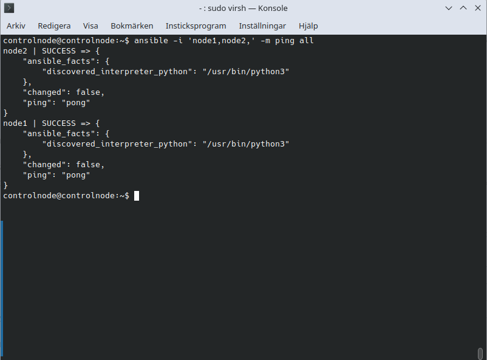

# Labb 1 – miljö och lösenordsfri SSH

## Mål

Skapa tre virtuella Linux-maskiner, konfigurera SSH-inloggning med nyckel och verifiera anslutningen till båda målnoderna med Ansible.

## Miljö

Jag skapade `node1` och `node2` med `virt-install` i värddatorns terminal. `controlnode` skapades med `virt-manager`. Alla tre kör Ubuntu Server 24.04 och använder samma virtuella NAT-nät i libvirt.

| VM | Roll | Användare för inloggning | Observerad IP-adress |
| --- | --- | --- | --- |
| `controlnode` | Kontrollnod för Ansible | `controlnode` | Inte noterad |
| `node1` | Hanterad nod | `node1` | `192.168.122.7` |
| `node2` | Hanterad nod | `node2` | `192.168.122.229` |

IP-adresserna delas ut med DHCP och kan ändras.

## Namnuppslagning

Jag installerade och aktiverade Avahi på alla tre virtuella maskiner:

```bash
sudo apt update
sudo apt install -y avahi-daemon
sudo systemctl enable --now avahi-daemon
```

Från `controlnode` testade jag att båda nodernas `.local`-namn gick att nå. Varje test fick tre svar och 0 % paketförlust:

```bash
ping -c 3 node1.local
ping -c 3 node2.local
```

## SSH-nycklar

På `controlnode` skapade jag ett nyckelpar av typen Ed25519 och kopierade den publika nyckeln till användarna på båda målnoderna:

```bash
ssh-keygen -t ed25519 -f ~/.ssh/ansible_lab -C "controlnode-ansible"
ssh-copy-id -i ~/.ssh/ansible_lab.pub node1@node1.local
ssh-copy-id -i ~/.ssh/ansible_lab.pub node2@node2.local
```

Jag verifierade att jag kunde logga in på båda servrarna med SSH-nyckeln. Den privata nyckeln ligger kvar på `controlnode` och finns inte i repot. Lokala SSH-alias gör det möjligt att använda `ssh node1` och `ssh node2`.

## Verifiering med Ansible

Jag testade båda noderna med de SSH-alias som är konfigurerade på `controlnode`:

```bash
ansible -i 'node1,node2,' -m ping all
```

Båda noderna svarade med `SUCCESS`, `"changed": false` och `"ping": "pong"`. Ansible hittade `/usr/bin/python3` på båda. Det visar att SSH-inloggningen fungerar och att Ansible kan köra en Python-modul på noderna.



Ansibles `ping` testar SSH-anslutningen och modulens körning, inte ICMP-paket som det vanliga `ping`-kommandot gör.

## Lärdom

Avahi översätter servernamnen till adresser, medan SSH sköter fjärrinloggningen. Det är två olika funktioner. Jag lärde mig också att skilja mellan kommandon som körs på värddatorn och kommandon som körs inuti en virtuell maskin.
