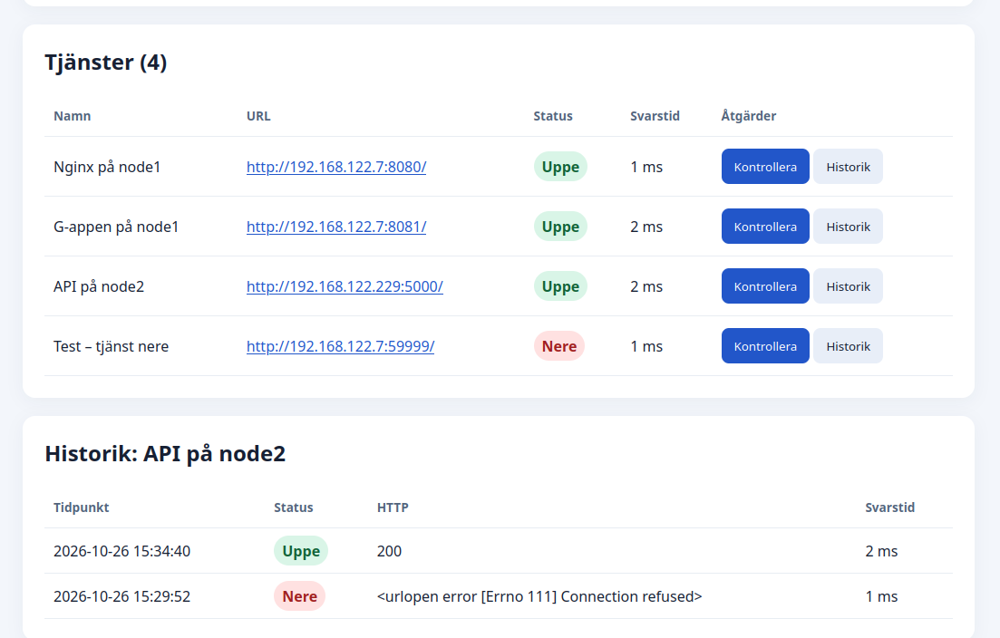

# Lab 10 – driftsättning av en flerskiktsapplikation

Labben driftsätter två versioner med Ansible. G-delen kopplar en Python-webbklient på node1 till ett API på node2. VG-delen driftsätter **Service Monitor**, en Flask-app med MariaDB.

## Arkitektur

| Nod | G-delen | VG-delen |
| --- | --- | --- |
| controlnode | Kör Ansible | Kör Ansible |
| node1 | Python-webbklient på port 8081 | Nginx på port 8082 → Gunicorn på 127.0.0.1:8000 → Flask |
| node2 | Python-API på port 5000 | MariaDB på port 3306 |

VG-appen ansluter från node1 till MariaDB på node2 med databaskontot `monitor_app`. Ansible hämtar IP-adresserna från nodernas fakta.

## Funktioner

- Registrera HTTP- och HTTPS-adresser i webbgränssnittet.
- Köra en kontroll från node1 med fem sekunders tidsgräns.
- Spara HTTP-status, svarstid, tillgänglighet och anslutningsfel i MariaDB.
- Visa aktuell status och de 20 senaste kontrollerna per tjänst.
- Kontrollera adresser i labbnätet och externa adresser som node1 kan nå.

Kontroller körs när användaren klickar på **Kontrollera** eller anropar API:et. Schemalagda kontroller, larm och kontroll av förväntat innehåll är möjliga vidareutvecklingar.

## Filer

```text
ansible.cfg
inventory.ini
playdebug.yml                   # G-delen
templates/                      # Python-mallar för G-delen
vg.yml                          # Huvudplaybook för VG
vg-db.yml                       # Installation och konfiguration av MariaDB
vg-web.yml                      # Flask, Gunicorn, systemd och Nginx
vg/schema.sql                   # Tabellerna services och checks
vg/secrets.yml                  # Krypterat databaslösenord (Ansible Vault)
vg/app/app.py                   # Flask-API och HTTP-kontroller
vg/app/requirements.txt         # Pythonberoenden
vg/app/templates/index.html     # Webbgränssnittet
vg/templates/                   # Konfigurationsmallar
```

## Driftsättning

Förutsättningar: Ansible på controlnode, SSH och sudo på båda noderna samt Ansible-samlingen `community.mysql`. Anpassa `inventory.ini` för din miljö.

Vid en ny installation skapas `vg/secrets.yml` krypterad med Ansible Vault. Filen ska innehålla variabeln `db_password`. Spara aldrig Vault-lösenordet eller en okrypterad kopia i repot.

```bash
ansible-vault create vg/secrets.yml
ansible-playbook vg.yml --syntax-check --ask-vault-pass
ansible-playbook vg.yml -K --ask-vault-pass
```

Öppna VG-appen på `http://<node1-ip>:8082/`. Kör G-delen separat med `ansible-playbook playdebug.yml` och öppna `http://<node1-ip>:8081/`. G-processerna startas med `nohup` och kan behöva startas igen efter omstart; VG-appen, Nginx och MariaDB körs som systemd-tjänster.

## Verifiering

En upprepad körning av VG-playbooken gav `changed=0` på både node1 och node2. Webbgränssnittet registrerade tjänster och visade status och historik från MariaDB.

- Nginx på node1 svarade med HTTP 200.
- API:t på node2 gick från `Connection refused` till HTTP 200; båda resultaten syns i historiken.
- En avsiktligt stängd port visades som **Nere**.
- En extern HTTPS-kontroll svarade med HTTP 204 på 90 ms.

```bash
curl -i http://<node1-ip>:8082/api/services
curl -X POST http://<node1-ip>:8082/api/services/1/check
curl http://<node1-ip>:8082/api/services/1/checks
ansible node1 -b -K -m command -a 'systemctl is-active service-monitor'
ansible node2 -b -K -m shell -a "mariadb -e 'SHOW TABLES FROM service_monitor;'"
```

### Webbgränssnitt

Skärmbilden visar tre tjänster som svarar, en avsiktligt otillgänglig tjänst och historiken där API:t på node2 gick från anslutningsfel till HTTP 200.



## API

| Metod | Adress | Funktion |
| --- | --- | --- |
| GET | `/api/services` | Lista tjänster |
| POST | `/api/services` | Lägg till en tjänst med JSON-fälten `name` och `url` |
| POST | `/api/services/<id>/check` | Kontrollera en tjänst och spara resultatet |
| GET | `/api/services/<id>/checks` | Visa de 20 senaste kontrollerna |

Labben använder privata IP-adresser och okrypterad trafik inom labbnätet. För användning utanför labbet behövs autentisering, HTTPS och begränsningar för vilka adresser som får registreras.
