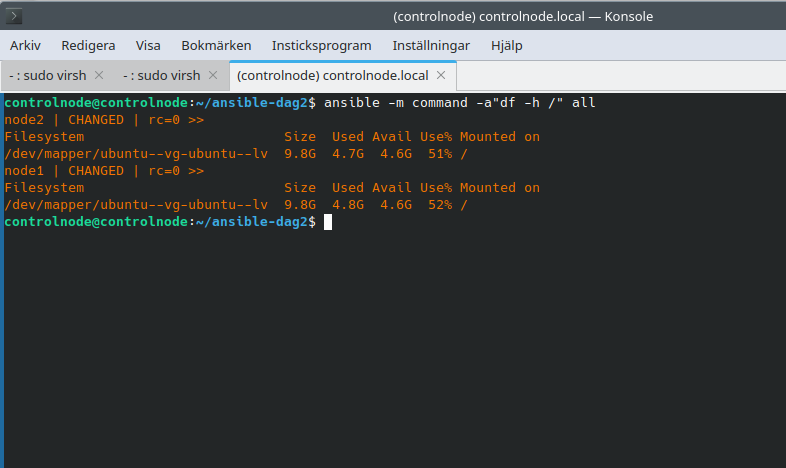
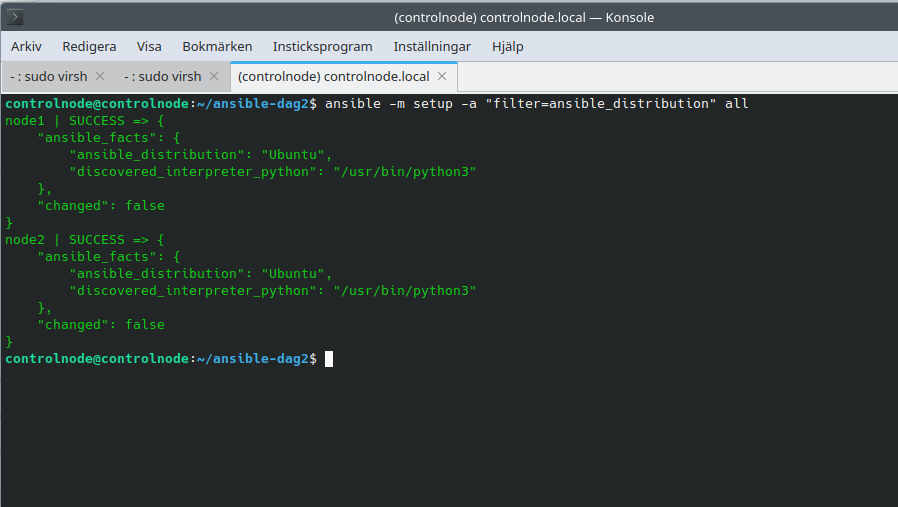

# Labb 2: Ad-hoc-kommandon

**Syfte:** Kontrollera diskutrymme och Linux-distribution på node1 och node2 med Ansible.

## Kommandon och resultat

Kommandona kördes från controlnode i `~/ansible-dag2`. Inventory valdes via `ansible.cfg` och innehöll båda noderna.

### Diskutrymme för rotfilsystemet

```bash
ansible -m command -a "df -h /" all
```

Båda noderna svarade utan fel (`rc=0`). Node1 använde 52 % och node2 51 % av rotfilsystemet vid kontrolltillfället.



### Linux-distribution

```bash
ansible -m setup -a "filter=ansible_distribution" all
```

Båda noderna rapporterade `Ubuntu` och `changed: false`. Modulen `setup` hämtade information utan att ändra noderna.


