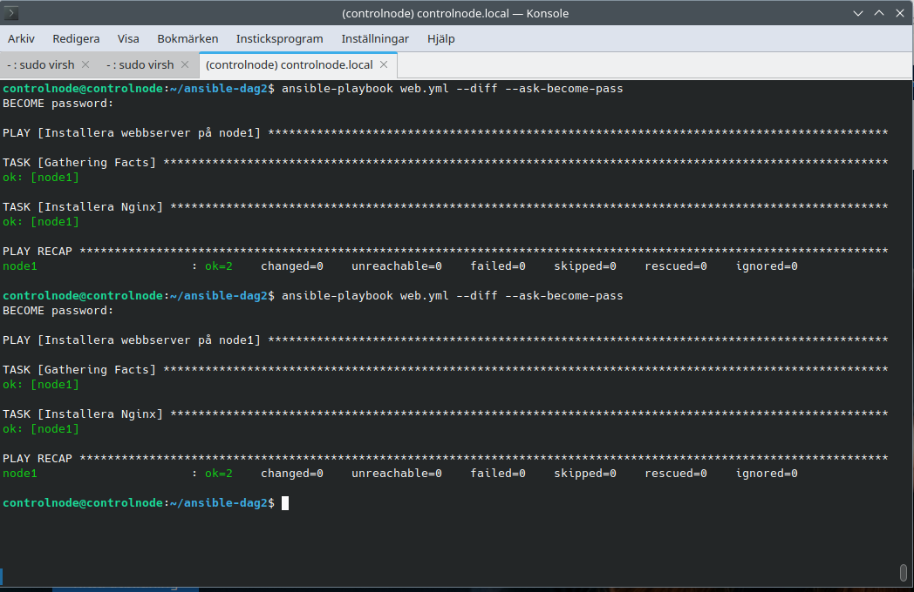

# Labb 3: Playbook och idempotens

**Syfte:** Säkerställa att Nginx är installerat på node1 och undersöka idempotens genom två körningar av samma playbook.

## Inventory och playbook

```ini
[webservers]
node1
```

Playbooken finns i [web.yml](web.yml). Den använder `hosts: webservers`, `become: true` och modulen `ansible.builtin.apt` med `name: nginx` och `state: present`.

## Körning och resultat

Följande kommando kördes två gånger från controlnode i `~/ansible-dag2`, där `ansible.cfg` valde inventory-filen:

```bash
ansible-playbook web.yml --diff --ask-become-pass
```

Båda körningarna gav `ok=2`, `changed=0`, `unreachable=0` och `failed=0` på node1.



## Förklaring av idempotens

Jag hade redan installerat Nginx på node1 under tidigare övningar. Därför gav båda körningarna `changed=0`. Om Nginx hade saknats skulle paketuppgiften ha installerat det och rapporterat en ändring. Vid efterföljande körningar behövs ingen ändring så länge paketet finns installerat. Detta visar idempotens: samma uppgift kan köras flera gånger utan onödiga ändringar när det önskade tillståndet redan är uppnått.
