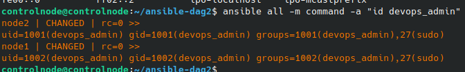
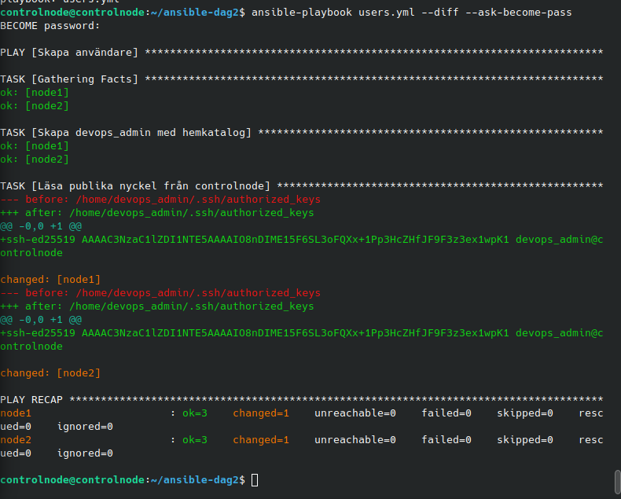

# Labb 4 – Användar- och behörighetshantering

## Genomförande

[users.yml](users.yml) skapar `devops_admin` på node1 och node2 med hemkatalog. `groups: sudo` ger medlemskap i sudo-gruppen och `append: true` bevarar andra extragrupper.

Ett eget nyckelpar skapades på controlnode:

```bash
ssh-keygen -t ed25519 -f ~/.ssh/devops_admin -C "devops_admin@controlnode"
ansible-playbook users.yml --syntax-check
ansible-playbook users.yml --diff --ask-become-pass
```

`ansible.posix.authorized_key` läser den publika nyckeln med `lookup('file', ...)` på controlnode och lägger den i användarens `~/.ssh/authorized_keys` på båda noderna. Den privata nyckeln stannar på controlnode.

## Verifiering

```bash
ansible all -m command -a "id devops_admin"
ssh -i ~/.ssh/devops_admin devops_admin@node1.local
whoami
exit
ssh -i ~/.ssh/devops_admin devops_admin@node2.local
whoami
exit
```

Båda noderna visade medlemskap i `sudo`. SSH-inloggningen fungerade utan användarlösenord på båda. Terminaltexten från node1 visade `whoami` → `devops_admin`; samma resultat på node2 bekräftades i chatten. En upprepad playbookkörning gav enligt användarens verifiering `changed=0`.





## Lärdom

Att spara en ändring i playbooken ändrar inte noderna. Playbooken måste köras igen. Medlemskap i sudo-gruppen och SSH-inloggning är separata delar; labben konfigurerar inte lösenordsfri sudo.
