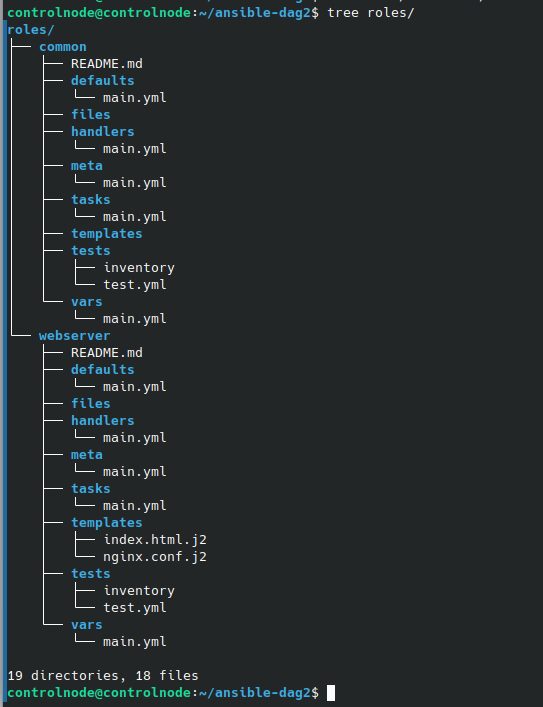
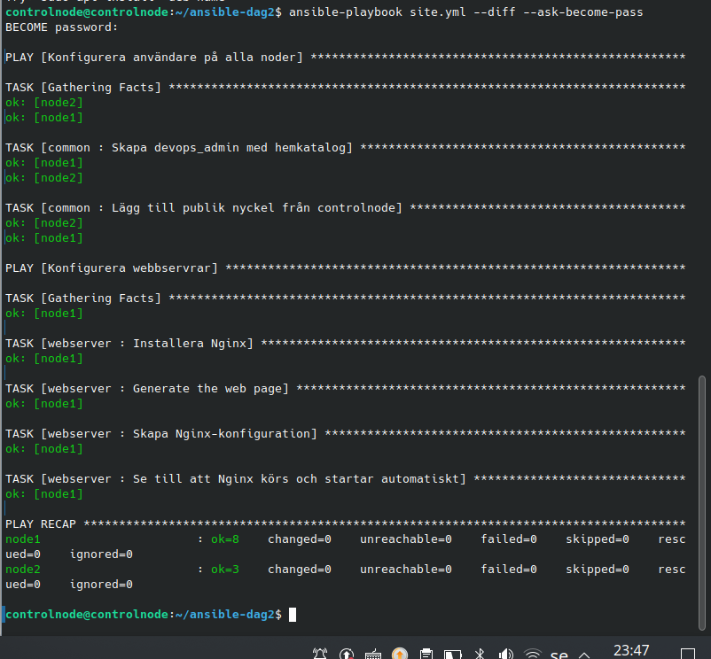

# Labb 5 – Strukturering med Ansible Roles (VG-upplägg)

## Genomförande

Rollstrukturen skapades med:

```bash
ansible-galaxy role init roles/webserver
ansible-galaxy role init roles/common
```

Användarskapande och SSH-nyckelhantering från labb 4 flyttades till [common/tasks/main.yml](roles/common/tasks/main.yml). Pakethantering, mallar och tjänstehantering ligger i rollen `webserver`. [site.yml](site.yml) kör `common` på `all` och `webserver` på `webservers` (node1).

Nginx installeras med `apt`, hålls startad med `ansible.builtin.service` och aktiveras för automatisk start. Konfigurationsuppgiften använder `notify: Restart Nginx`. Handlern startar om tjänsten när konfigurationen ändras; HTML-ändringar utlöser ingen omstart.

## Rollstruktur



Använda filer i paketet:

- `roles/common/tasks/main.yml`
- `roles/webserver/tasks/main.yml`
- `roles/webserver/defaults/main.yml`
- `roles/webserver/handlers/main.yml`
- `roles/webserver/templates/index.html.j2`
- `roles/webserver/templates/nginx.conf.j2`

## Verifiering

```bash
ansible-playbook site.yml --syntax-check
ansible-playbook site.yml --diff --ask-become-pass
tree roles/
```



Node1: `ok=8 changed=0 unreachable=0 failed=0`. Node2: `ok=3 changed=0 unreachable=0 failed=0`. Inga ändringar behövdes efter omstruktureringen. Under föregående övning ändrades `http_port` från 80 till 8080; konfigurationen uppdaterades och webbservern svarade därefter på port 8080. Vid oförändrad konfiguration kördes ingen handler.

## Lärdom

Huvudplaybooken väljer var rollerna körs. Roller samlar återanvändbara uppgifter och resurser, utan att varje taskfil behöver egna `hosts` eller `become`.
