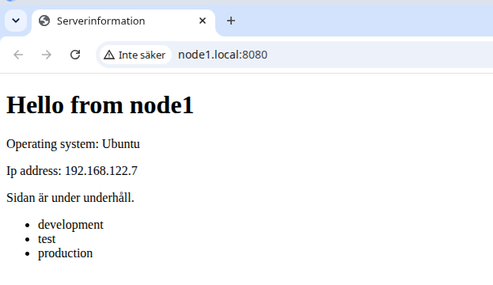

# Labb 6 – Dynamiska konfigurationsfiler med Jinja2

## Genomförande

[index.html.j2](roles/webserver/templates/index.html.j2) använder Ansible Facts för att visa:

- Hostname: `ansible_facts['hostname']`
- IP-adress: `ansible_facts['default_ipv4']['address']`
- Operativsystem: `ansible_facts['distribution']`

`ansible.builtin.template` renderar sidan till `/var/www/html/index.html`. Facts samlas in under `Gathering Facts`. Ett `if`-villkor styr underhållsmeddelandet och en `for`-loop visar listan `app_environments`.

[nginx.conf.j2](roles/webserver/templates/nginx.conf.j2) använder `http_port`, vars slutvärde är 8080. Före ersättning kontrolleras konfigurationen med `nginx -t -c %s` via `validate`. En ändrad konfigurationsfil meddelar handlern `Restart Nginx`.

## Verifiering

```bash
ansible-playbook site.yml --diff --ask-become-pass
curl http://node1.local:8080
```

Webbläsaren öppnades på `http://node1.local:8080`. Den visade node1, Ubuntu och 192.168.122.7 samt underhållstext och tre listpunkter.



## Lärdom och felsökning

`{{ ... }}` skriver ut värden, medan `` styr villkor och loopar. Felet `app_environments is undefined` löstes genom att lägga listan i rätt `defaults/main.yml`. En extrafil med namnet `main.yml:` togs bort efter kontroll. Svenska tecken visades korrekt efter att `<meta charset="UTF-8">` lades till. Slutversionen av mallen innehåller även avslutande `</body>` och `</html>`.

Enbart HTML-ändringar kräver ingen Nginx-omstart. Konfigurationsändringar utlöser handlern. När allt redan är i önskat tillstånd rapporterar en upprepad körning inga ändringar.
