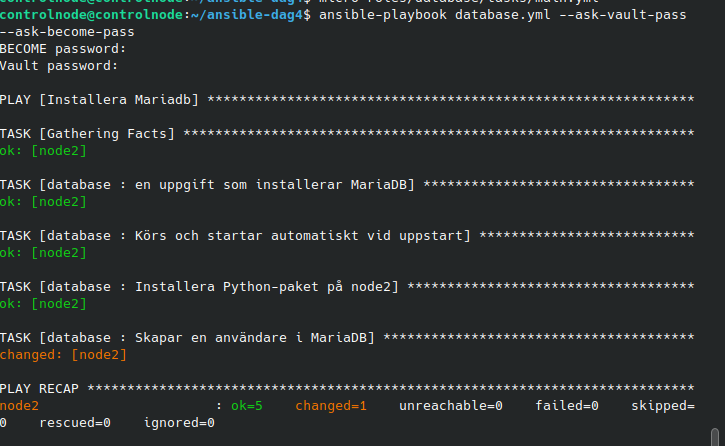
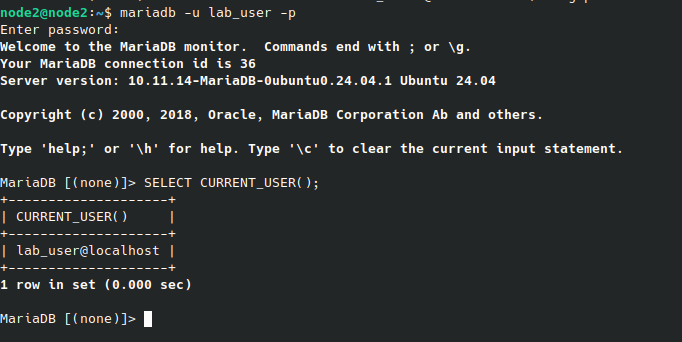

# Labb 7 – Secrets Management med Ansible Vault

## Genomförande

Jag skapade den krypterade variabelfilen `group_vars/all/vault.yml` med `ansible-vault create`. Den innehåller `vault_db_password` med databaslösenordet enligt labbinstruktionen. `cat` visar det krypterade innehållet, medan `ansible-vault view` låser upp filen med Vault-lösenordet. Ansible läser variablerna automatiskt från `group_vars/all`.

**G:** [secrets.yml](secrets.yml) skriver variabelns värde till `/tmp/secret.txt` på både node1 och node2. Filen ägs av root och har rättigheten `0600`. Körningen gav `changed=1` på båda noderna. Läsning utan sudo nekades; innehållet verifierades med sudo. Vault skyddar variabelfilen i projektet, men filen på målnoderna innehåller lösenordet i klartext.

**VG:** [database.yml](database.yml) anropar rollen [database](roles/database/tasks/main.yml) på gruppen `dbservers`, som innehåller node2. Rollen installerar MariaDB och `python3-pymysql`, säkerställer att tjänsten körs och startar vid uppstart samt skapar databasanvändaren `lab_user` med lösenordet från Vault. `no_log: true` ligger på uppgiftsnivå och döljer uppgiftens resultat i Ansible-utdata.

## Körning och verifiering

```bash
# G: ange Vault-lösenord och sudo-lösenord
ansible-playbook secrets.yml --ask-vault-pass --ask-become-pass

# VG: läs Vault-lösenordet från en lokal fil
ansible-playbook database.yml --vault-password-file pass_file/ansible-vault.pass --ask-become-pass
```

Efter att socket-sökvägen rättats skapades databasanvändaren: `ok=5`, `changed=1`, `failed=0`.



Jag loggade in på node2 med `mariadb -u lab_user -p`. SQL-frågan `SELECT CURRENT_USER();` visade `lab_user@localhost`.



En senare körning med Vault-lösenordsfilen gav `changed=0` och `failed=0`. Endast sudo-lösenordet behövde anges manuellt. Detta verifierade både upplåsning via fil och idempotens.

## Lösenordsfil och Git

`pass_file/ansible-vault.pass` innehåller Vault-lösenordet som låser upp variabelfilen. Det är ett annat lösenord än databaslösenordet. Katalogen har rättigheten `700` och lösenordsfilen `600`. Regeln `pass_file/` har lagts till i `.gitignore`.

Den krypterade `group_vars/all/vault.yml` ska finnas i repot, medan Vault-lösenordsfilen ska hållas utanför. Git-skyddet behöver även kontrolleras i det faktiska repot på värddatorn innan commit.

## Felsökning och lärdom

`no_log` placerades först inuti modulens parametrar, vilket gav ett fel. Det löstes genom att flytta det till samma nivå som modulnamnet. Ett dolt fel orsakades sedan av fel socket-sökväg. Kontroll med `ls` visade den korrekta sökvägen `/run/mysqld/mysqld.sock`.

Ett första inloggningsförsök nekades. `sudo` ändrar Linux-behörigheter och ersätter inte MariaDB-användarens databaslösenord. Inloggningen lyckades med rätt databaslösenord.
